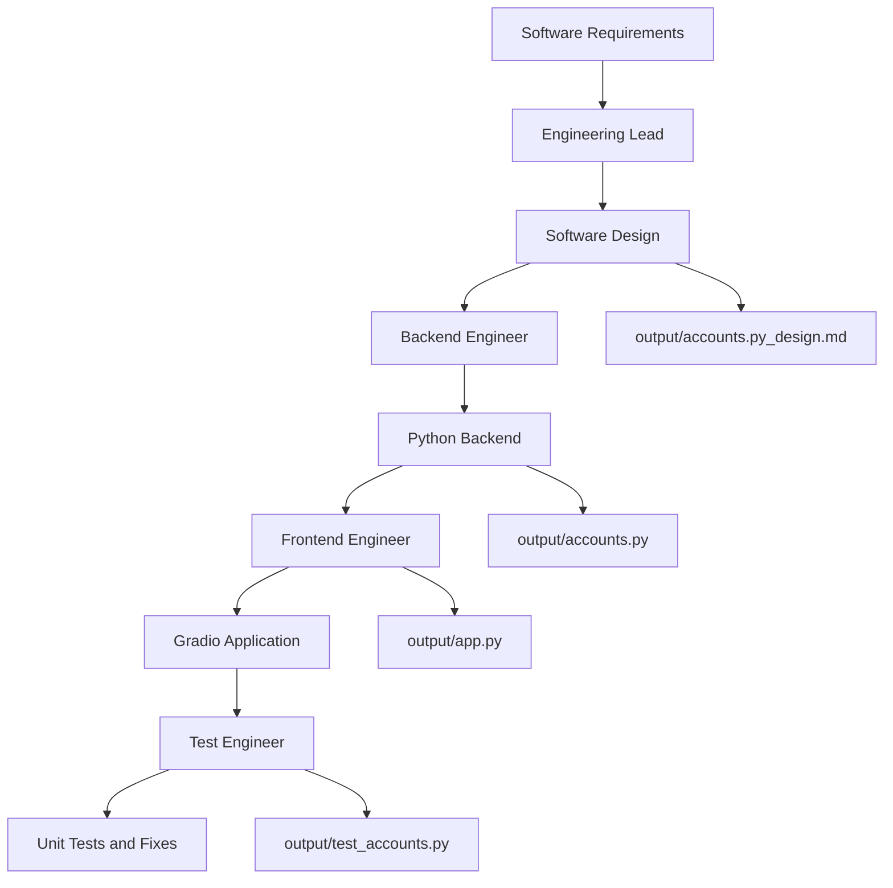

# Engineering Team — Multi-Agent AI Software Development System

A multi-agent software engineering application built with **CrewAI**. It uses specialized AI agents to transform high-level requirements into a software design, implement the backend, develop a user interface, and write and execute unit tests.

The current implementation builds an **Account Management System for a Trading Simulation Platform**. The system supports account creation, deposits, withdrawals, stock trading, portfolio valuation, profit and loss calculations, and transaction history.

The application uses CrewAI to coordinate four engineering roles: an engineering lead, backend engineer, frontend engineer, and test engineer.

## How It Works

The crew uses four specialized agents that execute sequentially:

1. **Engineering Lead:** Analyzes the requirements and produces a detailed software design, including modules, classes, function signatures, implementation responsibilities, and frontend guidance.
2. **Backend Engineer:** Implements the Python backend according to the design, including account management, cash transactions, share trading, holdings, and portfolio calculations.
3. **Frontend Engineer:** Develops a professional Gradio 6 interface that connects to the backend and provides an interactive trading simulation experience.
4. **Test Engineer:** Creates unit tests using Python's built-in `unittest` framework, executes them, identifies defects, and fixes backend issues where necessary.

Each task builds on the outputs of earlier tasks. The backend implementation receives the design as context, while the frontend and testing tasks receive the relevant design and implementation outputs.

The crew uses CrewAI's sequential process, executing the tasks in their configured order.



## Tech Stack

- **Python:** `>=3.10,<3.14`
- **CrewAI:** `1.14.4`
- **uv:** Dependency and environment management
- **MixRoute:** LLM API access
- **GPT-4.1:** Model configured for the engineering agents
- **DeepSeek V4 Flash:** Additional model configured in the crew
- **Gradio:** `>=6.30.0` for the web interface
- **Pydantic:** Used by CrewAI's custom tool schema
- **Python `unittest`:** Backend unit testing
- **Python standard library:** Backend implementation, including date/time handling and data structures
- **YAML:** Agent and task configuration
- **Markdown:** Software design documentation

The backend implementation is designed to use Python's standard library rather than additional third-party libraries. Gradio is used for the frontend, while CrewAI and its dependencies power the development workflow.

## Agents and Models

| Agent | Responsibility | Model | Code Execution |
|---|---|---|---|
| Engineering Lead | Analyzes requirements and designs the system | GPT-4.1 | Not enabled |
| Backend Engineer | Implements the backend logic | GPT-4.1 | Enabled in safe mode |
| Frontend Engineer | Builds the Gradio interface | GPT-4.1 | Not enabled |
| Test Engineer | Writes and runs backend unit tests | GPT-4.1 | Enabled in safe mode |

The models are configured in `src/engineering_team/crew.py` through the MixRoute API endpoint.

The crew also defines a `deepseek-v4-flash` LLM configuration, although the four agent methods currently use the GPT-4.1 configuration.

The backend and testing agents have code execution enabled, with a maximum execution time of 240 seconds and up to five retries configured.

## Getting Started

### Prerequisites

Install the following:

- Python 3.10–3.13
- [uv](https://docs.astral.sh/uv/)
- A MixRoute API key for LLM access

### 1. Clone the Repository

```bash
git clone <your-repository-url>
cd crewai-engineering-team-main
```

Replace `<your-repository-url>` with your actual GitHub repository URL and adjust the directory name if necessary.

### 2. Install Dependencies

Install `uv` if it is not already available:

```bash
pip install uv
```

From the project root, install the dependencies:

```bash
uv sync
```

Alternatively, use the CrewAI installation command:

```bash
uv run crewai install
```

The project dependencies are defined in `pyproject.toml`, and the resolved versions are recorded in `uv.lock`.

### 3. Configure Environment Variables

Create a `.env` file in the project root:

```ini
MIXROUTE_API_KEY=your_mixroute_api_key
```

The LLM configurations in `src/engineering_team/crew.py` read this variable to authenticate requests to MixRoute.

Replace the placeholder with your actual API key. Keep `.env` private and ensure that it is excluded from Git commits.

### 4. Run the AI Engineering Team

From the project root, execute:

```bash
uv run run_crew
```

Alternatively:

```bash
uv run crewai run
```

The application starts from `src/engineering_team/main.py`, initializes the `EngineeringTeam` crew, and begins executing the configured tasks.

The generated design, backend, frontend, and test artifacts are written to the `output/` directory according to the output paths defined in `src/engineering_team/config/tasks.yaml`.

**Note:** The crew generates project files; it does not automatically guarantee that every generated artifact is correct or that all tests pass. Review the outputs and test results before using the generated application.

## Project Requirements

The current requirements are defined in `src/engineering_team/main.py` as a multiline Python string.

The system must support:

- Creating user accounts.
- Depositing and withdrawing funds.
- Buying and selling shares.
- Preventing withdrawals that exceed the available cash balance.
- Preventing purchases that exceed available funds.
- Preventing sales of shares that the user does not own.
- Calculating total portfolio value.
- Calculating portfolio profit or loss.
- Reporting holdings at a given point in the simulation.
- Maintaining a transaction history.
- Retrieving share prices through a `get_share_price(symbol)` function.

The current example uses fixed prices for AAPL, TSLA, and GOOGL rather than live stock market data.

## Account Management System

The generated backend implements the trading simulation using two primary classes.

### 1. UserAccount

The `UserAccount` class represents an individual user's account.

Its main attributes include:

- `username`: The account holder's username.
- `initial_deposit`: The first successful deposit.
- `cash_balance`: The currently available cash balance.
- `holdings`: A mapping of stock symbols to share quantities.
- `transaction_history`: A chronological record of account transactions.

Its primary methods include:

| Method | Purpose |
|---|---|
| `deposit(amount)` | Adds funds to the account |
| `can_withdraw(amount)` | Checks whether a withdrawal is permitted |
| `withdraw(amount)` | Withdraws funds when sufficient cash is available |
| `can_buy(symbol, quantity)` | Checks whether a share purchase is affordable |
| `buy_shares(symbol, quantity)` | Purchases shares and updates the cash balance |
| `can_sell(symbol, quantity)` | Checks whether sufficient shares are held |
| `sell_shares(symbol, quantity)` | Sells shares and credits the proceeds |
| `get_holdings()` | Returns the current holdings |
| `get_portfolio_value()` | Calculates cash plus the market value of holdings |
| `get_profit_loss()` | Calculates portfolio profit or loss |
| `get_transaction_history()` | Returns the transaction records |

### 2. UserManager

The `UserManager` class manages user accounts.

| Method | Purpose |
|---|---|
| `create_user(username)` | Creates a new account if the username is available |
| `get_user(username)` | Retrieves an existing account |
| `user_exists(username)` | Checks whether an account exists |

### 3. Share Price Utility

The `get_share_price(symbol)` function returns the configured price for a supported stock symbol.

| Symbol | Example Price |
|---|---:|
| AAPL | $150.00 |
| TSLA | $700.00 |
| GOOGL | $2,800.00 |

These prices are fixed test values and do not represent current market prices.

## Gradio User Interface

The project includes a Gradio web application in `output/app.py`.

The interface is designed to demonstrate the backend functionality through a clean, interactive dashboard.

Its functionality includes:

- Creating and selecting a user account.
- Viewing the available cash balance.
- Viewing total portfolio value and profit or loss.
- Depositing and withdrawing funds.
- Selecting a stock and buying shares.
- Selling shares held in the account.
- Viewing current holdings.
- Viewing transaction history.
- Refreshing the displayed account information.

The UI uses a custom visual theme based on the colors `#ecad0a`, `#209dd7`, and `#753991`, alongside neutral grays.

### Run the Gradio Application

After the backend file has been generated, start the interface from the project root:

```bash
uv run python output/app.py
```

Gradio will display a local URL in the terminal. Open that URL in your browser to interact with the application.

The application maintains account data in memory, so restarting it resets the session's accounts and transactions.

## Running Unit Tests

The project includes backend unit tests in `output/test_accounts.py`.

The tests use Python's built-in `unittest` framework and cover account management, financial operations, trading rules, and portfolio calculations.

Run the tests from the project root:

```bash
uv run python -m unittest discover -s output -p "test_*.py" -v
```

Alternatively, run the specific test file:

```bash
uv run python -m unittest output/test_accounts.py -v
```

The test suite includes coverage for:

- Creating accounts and rejecting duplicate usernames.
- Checking whether users exist.
- Depositing funds.
- Successful withdrawals and withdrawal restrictions.
- Buying shares and handling insufficient funds.
- Selling shares and preventing sales beyond available holdings.
- Retrieving holdings.
- Calculating portfolio value.
- Calculating profit or loss.
- Retrieving transaction history.
- Checking the configured share prices.

A successful test run should report that all executed tests pass. Use the actual test output to confirm the result rather than assuming that the generated code is error-free.
